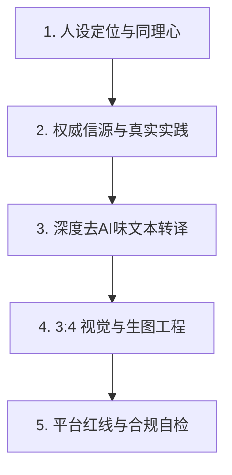
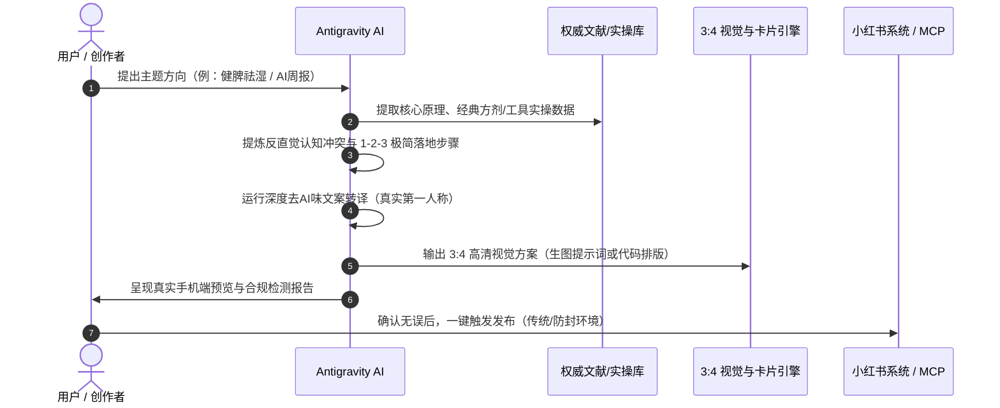

# 小红书高价值深度内容创作与视觉系统 (XHS Deep Content Creator)

本 Skill 旨在解决 AI 生成小红书内容时最致命的三大问题：**“假大空说教、信源虚构无依据、视觉劣质 AI 塑料感”**。通过建立垂直领域人设、锚定严谨事实信源、挖掘人类底层情绪痛点、以及工业级 3:4 高清视觉提示词工程，打造具备真实温度、高互动、高转化的长青优质 IP。

---

## 核心设计哲学：人类为什么愿意关注你？

在小红书，用户不需要冷冰冰的“AI 百科全书”，用户需要的是：
1. **一个有温度的同路人**：站在同一战壕，懂读者的亚健康、焦虑、加班与疲惫。
2. **一个可信赖的降噪者**：替读者读完晦涩的原典（经方古籍 / 官方文档 / 开源码），把复杂知识压缩为“3个能直接照抄的步骤”。
3. **一个负责任的避坑指南**：敢于说出局限性、禁忌和适用边界，不吹嘘神效，不搞虚假承诺。

---

## 创作五大核心原则 (Five Golden Pillars)

1. **真实第一人称白描 (Authentic Voice)**：
   - 彻底封杀 “在这个快节奏时代”、“众所周知”、“惊艳”、“天花板” 等 AI 套话。
   - 使用生活化真实叙事：“说真的，以前我经常……”、“亲测踩坑两个月才发现……”。
2. **严格信源溯源 (No Hallucination)**：
   - 中医内容：必须锚定原典（《伤寒论》《金匮要略》、倪海厦经方），严禁胡乱拼凑方剂，必须附带免责声明。
   - 科技内容：必须来自真机实操、真实工具输入输出对比与量化提效数据。
3. **视觉 3 秒定生死 (3:4 Visual Hierarchy)**：
   - 严格 3:4 纵向比例（1200×1600 或 1080×1440），移动端沉浸展示。
   - 顶部高反差标签与粗体大字标题（≤16字），中部结构化卡片或自然光静物摄影，底部安全行动号召。
4. **即时获得感 (Actionable Advice)**：
   - 每篇笔记必须交付 1~3 个“今天花5分钟就能照着做”的动作（如精准药材克重与煮法、工具提示词模板）。
5. **合规安全第一 (Compliance First)**：
   - 杜绝绝对化用语与医疗诱导承诺；正文杜绝生硬网址外链，引导评论区合法互动。

---

## 模块化指南索引

详细设计规范与深度模版请参阅本 Skill 内置参考文档：

| 模块 | 说明 | 对应参考文档 |
| :--- | :--- | :--- |
| **人设与受众** | 账号三维定位法、人类四大底层心理痛点、中医/科技人设范式 | [persona_and_audience.md](file:///C:/Users/kami/.gemini/config/skills/xhs-deep-content-creator/references/persona_and_audience.md) |
| **信源与事实** | 信源三大梯队（经典古籍/实操验证/爆款对标）、白话降维与合规底线 | [content_sourcing.md](file:///C:/Users/kami/.gemini/config/skills/xhs-deep-content-creator/references/content_sourcing.md) |
| **视觉与生图** | 3:4 构图物理规范、三大生图提示词范式（静物摄影/知识卡片/对比分镜）、负面提示词 | [visual_prompts_guide.md](file:///C:/Users/kami/.gemini/config/skills/xhs-deep-content-creator/references/visual_prompts_guide.md) |
| **提示词库** | 痛点挖掘、去AI味文案、视觉图方案、合规自检等 4 大阶段开箱即用 Prompt | [deep_prompts_templates.md](file:///C:/Users/kami/.gemini/config/skills/xhs-deep-content-creator/references/deep_prompts_templates.md) |

---

## 端到端标准执行流程 (Standard Operating Procedure)

当接到小红书内容创作需求时，按以下 SOP 严格执行：

### 第一步：信源核查与认知误区挖掘
- 确认该领域的经典出处与实测事实（例如：健脾祛湿陈皮茶源自经典理气健脾组合；AI 周报依托结构化 Prompt）。
- 提炼一个读者最容易犯的错误常识（如“狂喝冰美式反而水肿”）。

### 第二步：生成去 AI 味第一人称正文
- 采用 [deep_prompts_templates.md](file:///C:/Users/kami/.gemini/config/skills/xhs-deep-content-creator/references/deep_prompts_templates.md) 中的阶段二模板。
- 确保标题 $\le 20$ 字，正文短句自然，段落错落有致，包含真实体验、精确克重/参数及避坑提醒。

### 第三步：设计 3:4 高清视觉物料
- 根据内容类型选用合适范式：
  - **生活调理/中医药膳**：生成真实温润的自然光静物摄影提示词（参考 [visual_prompts_guide.md](file:///C:/Users/kami/.gemini/config/skills/xhs-deep-content-creator/references/visual_prompts_guide.md) 范式1）。
  - **工具干货/结构化经方**：生成 1200×1600 高对比度知识卡片（Pillow 或 Canvas 渲染）。

### 第四步：合规自检与手机端预览
- 运行违禁词自检（严禁绝对化词汇与非法疗效承诺，补齐温馨提示免责声明）。
- 通过手机端真实排版组件（`xhs-mobile-preview`）进行视觉验收。

### 第五步：双轨发布支持
- **传统 API 快速发布**：调用官方创作者中心直发接口，上传高清资产至 ROS Spectrum CDN 直达发布。
- **防封浏览器自动化**：调用 Camoufox 真实环境注入发布。
