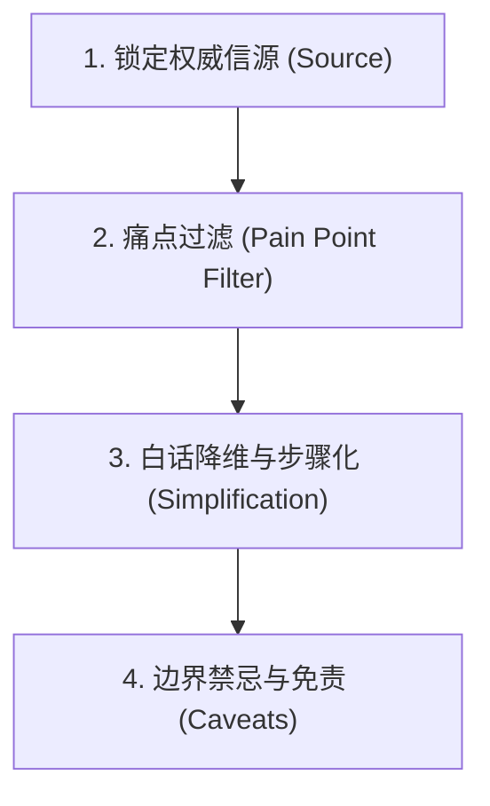

# 深度内容信源挖掘与真伪溯源规范 (Content Provenance & Source Anchoring)

AI 内容最容易被人诟病的就是“空洞无物、张嘴就来、事实幻觉”。深度有价值的小红书内容，**其每一句论断、每一个方子、每一个步骤都必须有据可查、有实测支撑**。

---

## 一、 内容信源三大梯队 (Hierarchical Source Matrix)

严禁直接让 AI 无约束发散生成！创作前必须明确当前内容的信源支柱：

```
第一梯队（权威经典 / 事实底层）
   ├── 中医：原典古籍（《伤寒论》《金匮要略》《黄帝内经》）、名家医案（倪海厦、李可、张锡纯）
   └── 科技/AI：官方文档（OpenAI/Google/Anthropic）、GitHub 高赞开源代码、官方一手 Release Note
              ↓
第二梯队（自身实操验证 / 真实踩坑记录）
   ├── 中医：亲身连续 14~30 天试饮体感变化、口感描述、舌象改善、煮制时间注意细节
   └── 科技/AI：本地环境实机运行截图、真实输入/输出对比、耗时量化（如：3小时降至5分钟）
              ↓
第三梯队（对标爆款洞察 / 痛点情绪提炼）
   └── 小红书近期万赞爆款笔记的结构化拆解（痛点引入方式、用户在评论区提出的真实困惑）
```

---

## 二、 知识提炼与降维四步法 (From Source to Note)

把严肃晦涩的源头资料，转化为小红书读者爱看、能懂、能用的“高浓度胶囊”：



### 步骤拆解：
1. **锁定信源 (Source)**：
   - 提取经方出处（如温胆汤源于《三因极病证方论》、四逆汤源于《伤寒论》）。
   - 提取工具核心原理（如该工具是利用 AST 解析还是利用多模态视觉模型）。
2. **痛点过滤 (Filter)**：
   - 筛选出对普通人生活/工作最有立竿见影帮助的部分，舍弃大段理论推演。
3. **白话降维与步骤化 (Simplification)**：
   - 将“中焦运化无力”翻译为“早起没胃口、吃完腹胀”。
   - 将克重、水温、火候标准化为“10克 + 500毫升水 + 大火煮沸转小火15分钟”。
4. **边界禁忌与免责 (Caveats)**：
   - 明确适用人群（如“适合寒湿体质，舌苔黄腻的湿热体质不宜”）。
   - 附带强制合规免责声明，杜绝医疗诱导与虚假承诺。

---

## 三、 绝对红线与去伪存真原则 (Truth & Compliance Guardrails)

1. **中医药与健康领域红线**：
   - 严禁宣称“包治百病”、“根治”、“彻底断根”。
   - 严禁开具剧毒中药或超大剂量处方（如附子、生半夏等有毒药材严格遵循法定规范，严禁网络轻率指导）。
   - 必须注明：“本文仅为中医古籍文献研读与个人养生心得探讨，不构成任何医疗诊断或处方建议，身体不适请务必就医”。
2. **工具与商业领域红线**：
   - 严禁虚标“月入过万”、“零基础躺赚”等割韭菜诱导。
   - 严禁推荐盗版、违规镜像或存在安全隐患的灰产工具。
   - 必须客观交代工具限制（如“免费额度有限”、“目前中文语境稍有瑕疵”）。
