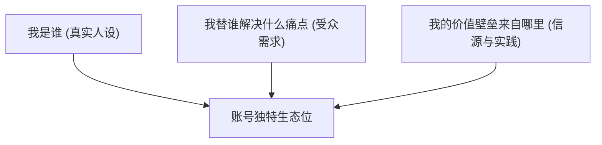

# 账号人设定位与人类痛点拆解指南 (Persona & Human Value)

在小红书，**用户关注的从来不是“一个完美的百科全书”，而是一个“懂我痛点、替我踩过坑的同路人”**。本指南拆解如何确立账号核心人设，以及如何精准洞察人类用户的深层心理需求。

---

## 一、 账号三维定位法 (IP Positioning Triangle)

在决定发第一篇笔记之前，必须严格明确三件事：

| 维度 | 致命错误（营销号套路） | 正确示范（高信任度 IP） |
| :--- | :--- | :--- |
| **身份定位** | 自称“养生大师”、“AI全网第一导师”居高临下说教 | **先行实践者/深度研读者**：自学中医2年的打工人、每天靠AI准时下班的职场老鸟 |
| **情绪温度** | 机械、冷冰冰、毫无波澜的书面官腔 | **共情、坦诚、带点自嘲**：“以前我每到周五也焦虑”、“换季我也经常舌苔厚重” |
| **价值交付** | 搬运概念、堆砌专业术语、看似很懂实则没用 | **傻瓜式极简行动**：给出精确克重/步骤/参数，今天回家花5分钟就能照着做 |

---

## 二、 人类读者真正关心的四大底层心理

人类点开一篇小红书并愿意双击点赞、点击收藏的心理机制只有 4 种：

### 1. 寻求痛苦的即时解药 (Instant Pain Relief)
- **痛点具象化**：不要说“脾虚”，要说“早晨起床眼皮肿、小肚子鼓鼓囊囊、吃两口就饱但体重往下掉”。
- **拒绝宏大叙事**：不要长篇大论讲阴阳五行或神经网络，直接告诉他：“喝这个茶，温热煮10分钟，舌苔齿痕变干净”。

### 2. 颠覆误区的认知顿悟 (Counter-Intuitive Insight)
- **打破常识盲区**：
  - *常识*：水肿就要喝大杯冰美式。
  - *反直觉真相*：脾胃喜温恶寒，天天冰美式直接浇灭中焦阳气，反而越喝越虚胖！
  - *常识*：写PPT先找模板再填字。
  - *反直觉真相*：模板只会让你花2小时对齐字体，先用 AI 吐出一句话大纲直接排版才是降维打击。

### 3. 规避风险与踩坑自护 (Risk Avoidance & Safety)
- 人性对“损失”的敏感度远超“获得”。
- 在内容中明确指出：**哪些人不能喝、哪个参数容易报错、哪种情况要立刻停下看医生**。越敢说局限性和禁忌，用户对你的信任度就越高。

### 4. 获得社交认同与表达欲望 (Social Currency & Identity)
- 用户点赞收藏，是在对自己说：“我是一个注重身体健康的人”、“我是一个追求高效聪明的职场人”。
- 文末互动话术设计：“大家平时属于湿热还是寒湿？评论区我来帮你看”、“你最痛苦的重复性工作是什么？告诉我我来写自动化”。

---

## 三、 两大垂直领域的标杆人设范式

### 范式 A：中医与经方调理（健康生活流）
- **核心定位**：当代亚健康自救手册，把深奥经方翻译成现代生活作息。
- **人设切片**：
  - “曾经也是天天熬夜外卖、舌苔厚腻手脚冰凉的打工人”。
  - “师从经典古籍（伤寒金匮）与倪海厦老师医案，用身体亲自验证经方”。
  - “从不神化中医，主张一人一方、辨证施治，身体不舒服必须遵医嘱”。

### 范式 B：AI 生产力与数字游民（职场高效流）
- **核心定位**：拒绝空谈大模型参数，只教普通人每天早下班2小时的实战工作流。
- **人设切片**：
  - “痛恨无意义形式主义加班、周报和假大空汇报”。
  - “每天实测10款新工具，只留下最顺手的3个，把复杂代码封装成一键脚本”。
  - “把省下来的时间用来生活、陪伴和副业探索”。
